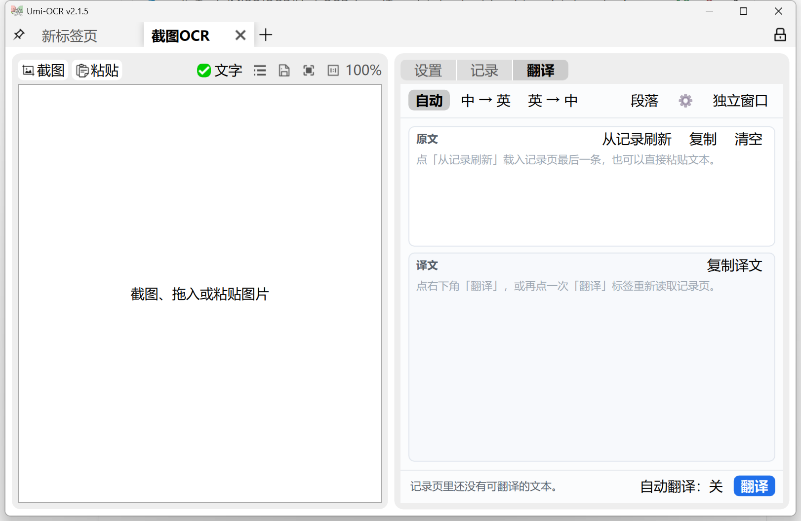
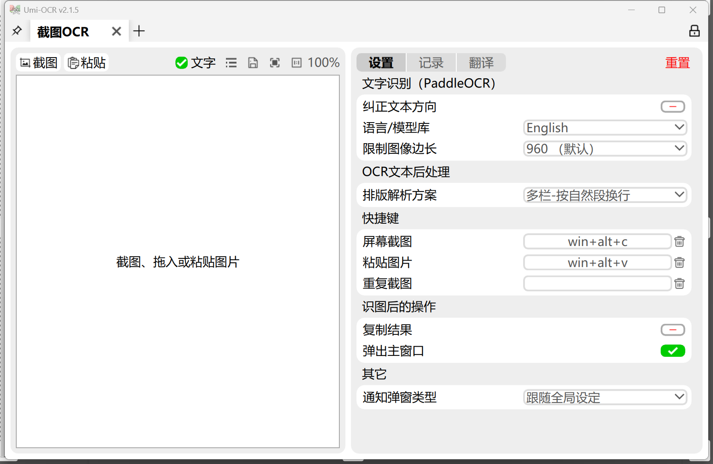

# Umi-OCR 本地离线翻译插件

给 **Umi-OCR v2.1.5（Windows x64）** 加一个**完全离线**的中英互译标签页：
截图识别完成后，右侧标签栏会多出一个「翻译」，点一下就把「记录」页最后一条结果翻译出来。

不联网、不需要 API Key、不修改 Umi-OCR 任何文件 —— 安装就是复制一个文件夹，卸载就是删掉它。



---

## 目录

- [功能特性](#功能特性)
- [环境要求](#环境要求)
- [安装](#安装)
- [使用](#使用)
- [配置](#配置)
- [常见问题](#常见问题)
- [卸载](#卸载)
- [从源码构建](#从源码构建)
- [项目结构](#项目结构)
- [实现要点](#实现要点)
- [已知限制](#已知限制)
- [AI 使用说明](#ai-使用说明)
- [许可证](#许可证)

## 功能特性

- **原生标签页**：「设置 | 记录 | 翻译」三选一互斥高亮，样式、悬停、切换动画都和 Umi 原生一致
- **读记录页的真实内容**：翻译的是「记录」页最后一条结果，**你在记录页手动改过的文字也会生效**
- **完全离线**：NLLB-200-distilled-600M + CTranslate2 int8，纯 CPU 推理，不发起任何网络请求
- **零依赖安装**：内置可重定位的 Python 3.12 运行时和依赖，整个文件夹可以直接拷到另一台电脑
- **可选独立窗口**：`Ctrl+Alt+T` 唤起独立翻译窗口，热键可在页面内开关和自定义，改完立即生效
- **长文本分段**：按段落翻译并可切到"逐行对照"，保留原文/译文对应关系
- **可移植自检**：自带 `verify_portable.py`，能扫描绝对路径并把整个插件复制到临时目录真实翻译一次



## 环境要求

- **Umi-OCR v2.1.5**（Windows x64）
- 支持 AVX2 的 CPU（2013 年后的处理器基本都满足）
- 磁盘约 760 MB
- 首次翻译时占用约 700 MB 内存

## 安装

1. 到本仓库的 **Releases** 下载 `umi_local_translate_vX.Y.Z.zip`（约 612 MB，解压后约 758 MB）
2. 解压，把 `umi_local_translate` **整个文件夹**放到：

   ```
   <Umi-OCR 安装目录>\UmiOCR-data\plugins\umi_local_translate
   ```

   复制完成后目录里应该有 `__init__.py`、`core\`、`qml\`、`service\`、`runtime\`、`models\`、`config.json`。
3. 启动 Umi-OCR → 打开「截图 OCR」标签页 → 标签栏里就会出现「翻译」

安装成功的标志：`plugins\umi_local_translate\logs\plugin.log` 里出现 `已注入「翻译」标签`。

## 使用

| 操作 | 效果 |
|---|---|
| 点「翻译」标签 | 读取「记录」页最后一条内容并翻译 |
| 页内「从记录刷新」 | 只重新读取记录页内容，不翻译 |
| 页内「翻译」 | 翻译「原文」框里的内容（可直接编辑） |
| 点「设置」/「记录」 | 切回对应页面（原生标签切换） |
| 「自动 / 中 → 英 / 英 → 中」 | 切换翻译方向，自动记住 |
| 「段落 / 逐行」 | 段落模式译文更通顺；逐行模式保留每行对应关系 |
| 「自动翻译：开」 | 每次 OCR 完成自动切到翻译页并翻译（默认关闭） |
| 「⚙」 | 独立窗口热键开关 + 热键自定义 |
| 「独立窗口」 | 把当前内容放进大窗口查看 |

几个说明：

- 翻译读的是**记录页里的实际内容**：手动改过的文字会被正确识别；有多条时取最后一条；记录被清空时回退到 OCR 事件里缓存的文本。
- 首次翻译要 3–6 秒加载模型，之后每条约 0.3–1 秒。翻译服务空闲 15 分钟后自动退出，下次点击会重新拉起。

## 配置

编辑 `plugins\umi_local_translate\config.json`，重启 Umi-OCR 生效：

```jsonc
{
  "enabled": true,          // 总开关
  "auto_translate": false,  // OCR 后自动翻译
  "direction": "auto",      // auto | zh-en | en-zh
  "embed_button": true,     // 在截图OCR页注入「翻译」标签
  "hotkey": "ctrl+alt+t",   // 独立窗口热键
  "hotkey_enabled": true,   // 热键开关
  "preload": false,         // 启动后立即预热服务（占用约 700MB 内存）
  "line_mode": "block",     // block（段落）| line（逐行）
  "service": {
    "port": 17321,          // 起始端口，被占用时自动往后找
    "idle_timeout": 900,    // 空闲多少秒退出服务
    "beam_size": 4,         // 1 最快，4 质量更好
    "threads": 0,           // 0 = 自动（CPU 核数 - 4，最多 12）
    "compute_type": "int8", // int8 | int8_float32 | float32
    "start_timeout": 90
  },
  "window": { "width": 760, "height": 420, "always_on_top": false }
}
```

独立窗口的大小、位置和置顶状态在窗口标题栏里调整，关闭时自动写回 `window`。

## 常见问题

**看不到「翻译」标签**

- 只出现在「截图 OCR」页面，其它页面没有
- 检查 `logs\plugin.log` 有没有 `已注入「翻译」标签`
- 如果日志里是 `注入失败：未找到 TabPanel/TabBar/SwipeView`，说明 Umi 版本改动了页面结构；
  把 `embed_button` 设为 `false` 可以关掉注入（热键和独立窗口仍然可用）

**一直显示"正在加载翻译模型…"**

- 详细原因见 `logs\service.log`
- 不要移动或改名 `models\nllb-200-distilled-600M-int8`

**提示"运行时缺失 / 模型缺失"**

- 说明文件夹没复制完整，重新完整复制一次（`runtime` 和 `models` 都必须存在）

**热键无效**

- 可能被其它软件占用，在「⚙」里换一个，例如 `ctrl+shift+t`

**升级 Umi-OCR 之后**

- 把插件文件夹重新复制到新的 `plugins\` 目录即可，配置和模型都在文件夹内

## 卸载

1. **先关闭 Umi-OCR**
2. 删除 `UmiOCR-data\plugins\umi_local_translate` 整个文件夹
3. 如果任务管理器里还有命令行包含 `server.py` 的 `pythonw.exe`，结束它

所有改动都是运行时的（标签页注入、事件订阅、热键），**不会在 Umi-OCR 或系统里留下任何东西**：
没有注册表项、没有 `%APPDATA%` 文件、没有服务。删除后重启 Umi-OCR 即恢复原样。

## 从源码构建

```powershell
powershell -ExecutionPolicy Bypass -File build.ps1     # 拉 CPython + 依赖 + 模型，组装并自检
powershell -ExecutionPolicy Bypass -File package.ps1   # 生成 dist\umi_local_translate_vX.Y.Z.zip
```

- 构建需要联网：用 `uv` 取 CPython 3.12，从 `hf-mirror.com` 下载 622 MB 的 CT2 模型
- 首次构建约 5–10 分钟（取决于网速）；之后有 `vendor\` 和 `models\` 时只做组装，约 30 秒
- `-RefreshRuntime` 重建运行时，`-RefreshModel` 重新下载模型
- 模型和运行时**不随仓库分发**：GitHub 单文件上限 100 MB，且模型是非商用许可

安装 / 卸载辅助脚本：

```powershell
powershell -ExecutionPolicy Bypass -File install.ps1 -UmiData "D:\Umi-OCR\UmiOCR-data"
powershell -ExecutionPolicy Bypass -File uninstall.ps1 -UmiData "D:\Umi-OCR\UmiOCR-data"
```

`-UmiData` 指向 `<Umi-OCR 安装目录>\UmiOCR-data`（也可用环境变量 `UMI_OCR_DATA`）。

测试：

```powershell
# 1) 服务端离线自检
build\umi_local_translate\runtime\python\python.exe build\umi_local_translate\service\selftest.py

# 2) 插件集成测试（QML 窗口 + 服务拉起 + 翻译 + 窗口几何）
$env:UMI_DATA = "D:\Umi-OCR\UmiOCR-data"
& "$env:UMI_DATA\runtime\python.exe" tests\test_backend.py build\umi_local_translate

# 3) 可移植性（复制到临时目录后真实翻译）
build\umi_local_translate\runtime\python\python.exe build\umi_local_translate\tools\verify_portable.py --relocate
```

## 项目结构

```
Umi-OCR_LocalTranslate\
├─ src\umi_local_translate\     插件源码（= 最终放进 plugins 的文件夹）
│  ├─ __init__.py               注册 "translate" 插件组 + 启动 hook
│  ├─ core\                     Umi 内置 Python 3.8 里运行的部分（Qt/PySide2）
│  │  ├─ bootstrap.py           安装入口（幂等）
│  │  ├─ compat.py              查找 Umi 内部模块、注册插件组、订阅 OCR 事件
│  │  ├─ app.py                 事件 / 热键 / 服务 / 界面装配
│  │  ├─ embed.py               把「翻译」标签注入截图OCR页（运行时，不改 Umi 文件）
│  │  ├─ backend.py             QML 后端：属性、槽、线程编组
│  │  ├─ ui.py                  独立翻译窗口（QQuickView）
│  │  ├─ service_manager.py     翻译服务的健康检查 / 拉起 / 请求
│  │  ├─ hotkey.py              ctypes 全局热键（支持运行时重注册）
│  │  └─ config.py / paths.py / log.py
│  ├─ qml\                      EmbedTabButton / EmbedPanel / EmbedInstaller / PaneCover / TBtn / Btn / TranslateWindow
│  ├─ service\                  独立的 Python 3.12 进程
│  │  ├─ server.py              标准库 HTTP 服务（/health /translate /shutdown）
│  │  ├─ engine_nllb.py         NLLB + CTranslate2 推理、分段、缓存
│  │  ├─ nllb_tokenizer.py      只依赖 tokenizers
│  │  ├─ segment.py             长文本分段与按原结构拼回
│  │  └─ selftest.py            离线自检
│  ├─ tools\
│  │  ├─ verify_portable.py     可移植性自检（--relocate 会真跑一次翻译）
│  │  ├─ rebuild_runtime.ps1    重建 runtime\site-packages
│  │  └─ fallback_pth\          备用 .pth 引导（极端情况下使用）
│  ├─ config.json               用户配置（随文件夹搬移）
│  └─ README.md                 面向使用者的详细手册
├─ docs\screenshots\            README 用的截图
├─ tests\test_backend.py        插件集成测试
├─ tools\capture.ps1            开发调试用（把 Umi 窗口置顶并截图）
├─ build.ps1 / package.ps1 / install.ps1 / uninstall.ps1
└─ README.md
```

> `vendor\`、`models\`、`build\` 都是 `build.ps1` 生成的中间产物，不保留在仓库里。

## 实现要点

### 为什么"放进 plugins 就能用"

Umi-OCR v2.1.5 的插件加载器（`py_src/plugins_controller/plugins_controller.py`）
只内置 `PLUGINS_GROUPS = ["ocr"]`，但它是**先 `import` 插件包、再做组名校验**。
插件 `__init__.py` 在导入阶段把 `"translate"` 追加进 `PLUGINS_GROUPS`，并为
`pluginsDict / optionsDict` 预建空槽位，校验即通过：不会弹"插件加载失败"、
不会出现在 OCR 引擎下拉框、也不修改 Umi 任何文件。

若未来版本改了加载器，`core/compat.py` 会用 `sys.modules` 兜底查找；仍失败时可用
`tools/fallback_pth`（把 `.pth` 拷到 `plugins\` 根目录，并把插件的 `__init__.py` 改名禁用）。

### 为什么不用 venv / 为什么能整体拷走

uv 的 venv 不可重定位（`pyvenv.cfg`、`Scripts\*.exe` 都写死绝对路径）。所以运行时是：

- `runtime\python`：python-build-standalone 的 CPython 3.12（可重定位，含 `pythonw.exe`）
- `runtime\site-packages`：`uv pip install --target` 安装，无启动器、无绝对路径

服务进程启动时自己把 `runtime\site-packages` 插到 `sys.path`，所有路径都从 `__file__` 推导。

### 「翻译」标签是怎么进到 Umi 界面里的

`core/embed.py` 把「翻译」做成**真正的第三个标签页**，全程不改 Umi 文件：

| 步骤 | 做法 |
|---|---|
| 第三个标签 | 从 `TabBar` 里取出原生标签用的 `Repeater.delegate` 组件，用带 `modelData={title:"翻译"}` 的子上下文克隆一份 → `TabBar.addItem()` |
| 第三个页面 | `EmbedPanel.qml` → `SwipeView.addItem()` |
| 状态 | 交给 Umi 的 `Container`（TabBar / SwipeView）控制器：选中态、互斥高亮、切换动画都是原生的 |

定位**不依赖文件名 / 版本号**：

- 主窗口：`contentItem` 带 `theme` 属性的 `QQuickWindow`
- 截图OCR页：带 `msnState` 属性的 Item（全项目只有 `ScreenshotOCR.qml` 有）
- 标签栏 / 内容区 / 记录模型：`TabPanel` → `TabBar` / `SwipeView` / `tabsModel["ocrResult"]`

踩过并已处理的坑：

1. `QQmlComponent.create()` 出来的对象默认是 JS 所有权，下次创建对象时可能被 QML 的 GC 回收 →
   `shiboken2.transferOwnershipToPython()` 并持有引用
2. `theme` 是 QML 自定义类型，`QObject.property()` 读不到 → 把主窗口对象作为上下文属性传给 QML，
   由 QML 自己取 `hostWindow.theme` / `hostWindow.size_`
3. `TabBar.addItem()` / `SwipeView.addItem()` 是 QML 的 Q_INVOKABLE，PySide2 调不到 →
   由 `EmbedInstaller.qml` 在 `Component.onCompleted` 里调用
4. Umi 用 `TabPanel.indexChangeNum < 2` 判断"用户是否手动切过标签"来决定识图后要不要自动切到记录页；
   翻译页的进出会顺带 +1，所以在 `onTabChanged` 里用 `QTimer.singleShot(0)` 减回去
5. `SwipeView` 的 `clip` 是 `false`，`TabPanel` 的 `clip: true` 没有作用到这些页面上，
   切换动画时页面会画到左侧识图区（闪一下）→ 把左侧识图面板抬到上层 + 在它下面垫一层同色底衬
   （`PaneCover.qml`）；**不要**去改页面的 `visible` 绑定（会引起大量异常行为）
6. 页面是懒加载的、关掉会销毁 → 800ms 轮询补注入，控件随页面一起销毁

### 线程模型

- 插件跑在 Umi 的 Python 3.8 主线程（Qt GUI 线程）
- `<<ScreenshotOcrEnd>>` 可能从工作线程发出 → 统一用 `Backend` 的 Signal 排队回主线程
- 翻译请求在独立线程里发 HTTP，结果同样通过 Signal 回主线程再改 QML 属性
- 关键点：**属性 notify 信号只能从主线程发**（QML 绑定是直连，跨线程会出问题）

### 翻译质量相关

- 源端 token 序列必须是 `[src_lang] + tokens + ["</s>"]`；去掉 `</s>` 输出会崩坏
- 目标语言用 `target_prefix=[[tgt_lang]]` 强制
- `beam_size=4` 明显优于 2，代价约 1.7 倍耗时（短句仍在 0.5 秒内）

## 已知限制

- 只支持中英（NLLB 本身支持 200 种语言，改 `LANG_TAG` 即可扩展）
- CPU int8；GPU 需要额外安装 CUDA 版 ctranslate2
- 首次翻译需 3–6 秒启动服务并加载模型
- 「翻译」是通过 `TabBar.addItem` / `SwipeView.addItem` 挂进 Umi 容器的：样式和交互都是原生的，
  但依赖 Qt Quick Controls 2 的 Container 接口；Umi 大版本更新若换掉 TabPanel 结构，需要同步调整 `embed.py`
- 翻译页不参与 Umi 的「手动切换次数」统计，进出翻译页不影响"识图后自动切到记录页"的行为

## AI 使用说明

本项目在 **AI 编程助手**的协助下完成，在此明确说明，方便使用者评估。

- **使用工具**：OpenCode（AI 编码代理）+ DeepSeek 模型
- **AI 参与的部分**：插件框架与运行时注入（`embed.py`）、QML 界面、翻译服务、构建/打包脚本、文档撰写、问题定位与调试
- **人工负责的部分**：需求定义与方案取舍、界面验收、真机功能测试、发布决策
- **验证方式**：功能不是"生成即交付"，都在真实的 Umi-OCR v2.1.5 环境中实测过 ——
  截图 OCR → 翻译、三个标签的互斥切换、记录页内容修改后重新翻译、独立窗口热键、
  删除文件夹后的卸载、整个目录复制到其他路径后的可移植性
- **提醒**：AI 生成的代码仍建议自行审阅后再用于生产环境；本项目按 MIT "AS IS" 提供，不附带任何担保

## 许可证

- 本仓库代码：**MIT**，见 [LICENSE](LICENSE)
- 翻译模型 `nllb-200-distilled-600M`：**CC-BY-NC 4.0（非商用）**，由 Meta 发布，
  构建时从 Hugging Face 镜像下载，**不随本仓库分发**
- 运行时依赖：`ctranslate2`(MIT) / `tokenizers`(Apache-2.0) / `numpy`(BSD) / CPython(PSF)
- Umi-OCR 本身为 MIT 许可，本项目不修改其任何文件
